<picture>
  <source media="(prefers-color-scheme: dark)" srcset="assets/banner-dark.svg">
  
</picture>

  🔬 <b>Master’s in Information Sciences Student</b> at Tohoku University 
  💼 Open to <b>ML Engineer</b>, <b>Research Engineer</b> and <b>AI Research Intern</b> roles · Japan · Malaysia · Remote

  
  

## About me

- 🎓 **Master's student in Information Sciences** at Tohoku University. My research focus federated learning for mammography diagnosis more **explainable and trustworthy**, so hospitals can train together without sharing patient data.
- 💻 **1.5 years as a full-stack web developer** at Willowglen, building and extending industrial software products (Sep 2024 – Mar 2026).
- 🤖 **AI software engineer (freelance)** at IntelliLabs AI, building AI-powered software for clients (2024 – 2025).
- 🔧 **Software engineering intern** at NXP Malaysia, where I led an internal calibration system and equipment monitoring dashboards.
- 🏆 **Champion, ImagineHack 2024** ("Gen-AI for Global Goals"): an AI-assisted project management system.

## Featured projects

<table>
  <tr>
    <td width="50%" valign="top">
      <h3><a href="https://github.com/NFL-Nujaimin/Sentiment-Analysis-of-IOI-Restaurant-Review">💬 Restaurant review sentiment analysis</a></h3>
      End-to-end NLP pipeline: scraped 2,500+ Google reviews, then sentiment classification (TextBlob vs VADER, 80% accuracy), LDA topic modelling and a Power BI dashboard.  
      <code>Python</code> <code>NLTK</code> <code>scikit-learn</code> <code>Selenium</code> <code>Power BI</code>
    </td>
    <td width="50%" valign="top">
      <h3><a href="https://github.com/NFL-Nujaimin/Forecasting-using-Machine-Learning-Algorithm">🚆 Transit ridership forecasting</a></h3>
      Forecasts daily Klang Valley public transport ridership from Malaysian open data, comparing linear regression with a Keras neural network.  
      <code>Python</code> <code>TensorFlow/Keras</code> <code>scikit-learn</code> <code>pandas</code>
    </td>
  </tr>
  <tr>
    <td width="50%" valign="top">
      <h3><a href="https://github.com/NFL-Nujaimin/newspaper-delivery">🗞️ Newspaper delivery app</a></h3>
      Offline-first PWA built for real delivery routes: map navigation, route progress and on-device data only. <a href="https://nfl-nujaimin.github.io/newspaper-delivery/">Live demo</a>  
      <code>JavaScript</code> <code>PWA</code> <code>Service Worker</code> <code>Leaflet</code>
    </td>
    <td width="50%" valign="top">
      <h3><a href="https://github.com/NFL-Nujaimin/ActiveTen-Mobile-Application">🏃 ActiveTen fitness app</a></h3>
      Cross-platform mobile app for 10-minute workouts, with progress tracking and calorie estimates.  
      <code>C#</code> <code>.NET MAUI</code> <code>Firebase</code>
    </td>
  </tr>
</table>

**🚧 Currently building:** a federated learning benchmark (Flower + PyTorch, FedAvg vs FedProx on non-IID medical images) and an explainable chest X-ray classifier (Grad-CAM vs Integrated Gradients, with a live demo).

## Tech stack

<picture>
  <source media="(prefers-color-scheme: dark)" srcset="assets/tech-stack-dark.svg">
  
</picture>

## Let's connect

I'm always happy to talk about medical AI, federated learning or ML engineering roles.
