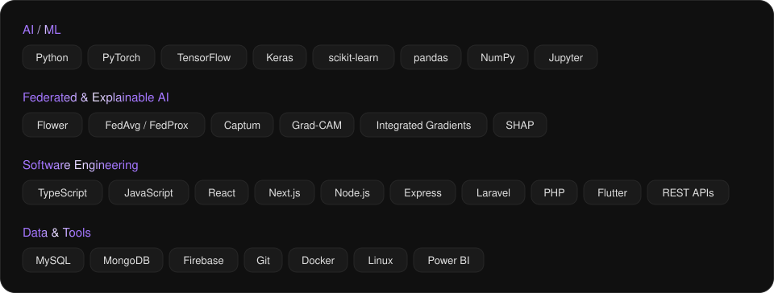

<picture>
  <source media="(prefers-color-scheme: dark)" srcset="assets/banner-dark-v2.svg">
  
</picture>

  🎓 <b>Master’s student in Information Sciences</b> at Tohoku University 
  💼 Open to <b>ML Engineer</b>, <b>Research Engineer</b> and <b>AI Research Intern</b> roles · Japan · Malaysia · Remote

  
  
  

## About me

- 🔬 **Research at Tohoku University:** the intersection of *Federated Learning* and *Explainable AI (XAI)* for the medical industry.
- 💻 **1.5 years as a full-stack web developer** at Willowglen, building and extending industrial software products (Sep 2024 – Mar 2026).
- 🤖 **AI software engineer (freelance)** at IntelliLabs AI, building AI-powered software for clients (2024 – 2025).
- 🔧 **Software engineering intern** at NXP Malaysia, where I led an internal calibration system and equipment monitoring dashboards.
- 🏆 **Champion, ImagineHack 2024** ("Gen-AI for Global Goals"): an AI-assisted project management system.

## Featured projects

<table>
  <tr>
    <td width="50%" valign="top">
      <h3><a href="https://github.com/NFL-Nujaimin/federated-learning-medmnist">🏥 Federated learning on medical images</a></h3>
      FedAvg vs FedProx across 10 simulated hospitals on PathMNIST, under IID and non-IID (Dirichlet) splits. Non-IID data cuts accuracy from 85.9% to 81.7%, and in the most skewed case FedProx recovers 1.3 points and halves the variance.  
      <code>Flower</code> <code>PyTorch</code> <code>Federated Learning</code> <code>MedMNIST</code>
    </td>
    <td width="50%" valign="top">
      <h3><a href="https://github.com/NFL-Nujaimin/explainable-pneumonia-classifier">🩻 Explainable pneumonia classifier</a></h3>
      ResNet-18 on chest X-rays (PneumoniaMNIST, test AUC 0.976), with Grad-CAM and Integrated Gradients compared by a deletion-curve faithfulness test: Grad-CAM wins clearly (0.390 vs 0.533). <a href="https://huggingface.co/spaces/NFL-Nujaimin/explainable-pneumonia-classifier">Live demo</a>  
      <code>PyTorch</code> <code>Captum</code> <code>Grad-CAM</code> <code>ONNX</code> <code>Hugging Face</code>
    </td>
  </tr>
  <tr>
    <td width="50%" valign="top">
      <h3><a href="https://github.com/NFL-Nujaimin/Sentiment-Analysis-of-IOI-Restaurant-Review">💬 Restaurant review sentiment analysis</a></h3>
      End-to-end NLP pipeline: scraped 2,500+ Google reviews, then sentiment classification (TextBlob vs VADER, 80% accuracy), LDA topic modelling and a Power BI dashboard.  
      <code>Python</code> <code>NLTK</code> <code>scikit-learn</code> <code>Selenium</code> <code>Power BI</code>
    </td>
    <td width="50%" valign="top">
      <h3><a href="https://github.com/NFL-Nujaimin/Forecasting-using-Machine-Learning-Algorithm">🚆 Transit ridership forecasting</a></h3>
      Forecasts daily Klang Valley public transport ridership from Malaysian open data, comparing linear regression with a Keras neural network.  
      <code>Python</code> <code>TensorFlow/Keras</code> <code>scikit-learn</code> <code>pandas</code>
    </td>
  </tr>
</table>

## Tech stack

<picture>
  <source media="(prefers-color-scheme: dark)" srcset="assets/tech-stack-dark-v2.svg">
  
</picture>
